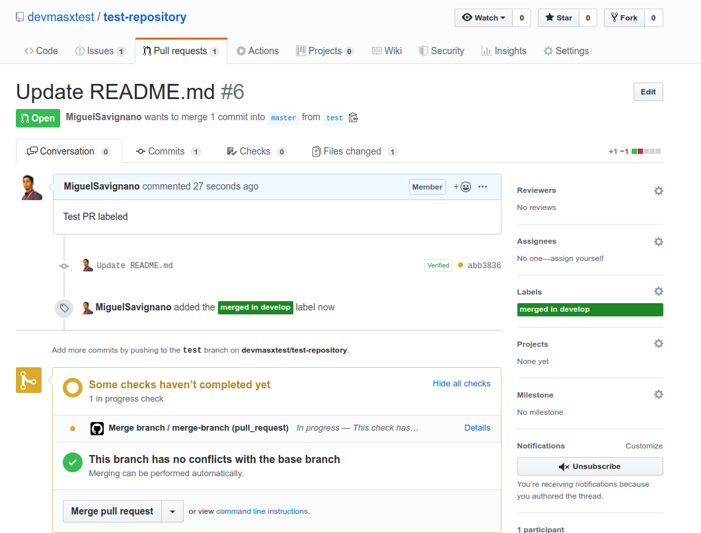
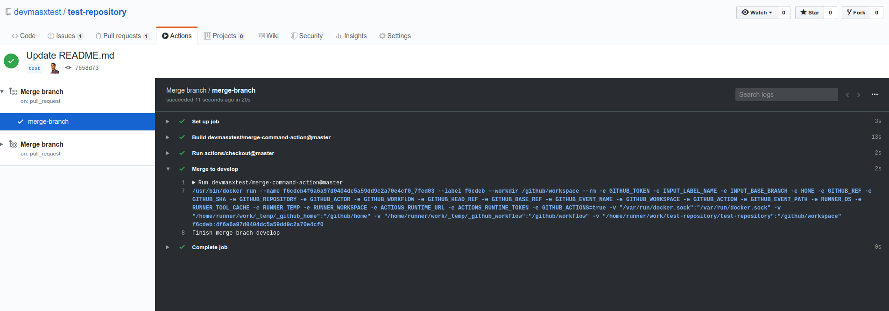
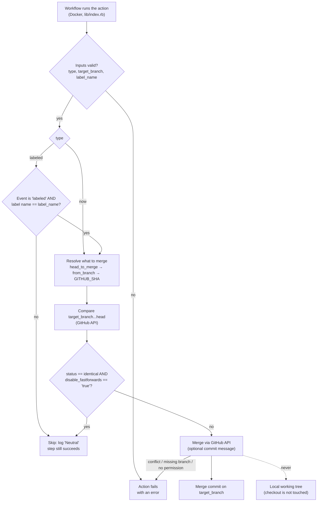

# Merge branch action

A GitHub Action that merges one branch into another from your CI, either on every run or only
when a pull request gets a specific label.

> Useful for keeping environment branches in sync (`development` → `staging` → `uat`) or for
> sending a pull request to a shared branch like `develop` by adding a label, without
> having to merge it by hand. Code: [`lib/index.rb`](lib/index.rb),
> [`lib/services/merge_branch_service.rb`](lib/services/merge_branch_service.rb).

## What problem it solves

Teams with several long-lived branches (one per environment, or a shared integration branch)
often have to copy work from one branch to another by hand. That step gets forgotten, and then
environments drift apart.

This action does the copy for you:

- **`now` mode**: every time the workflow runs, merge branch A into branch B. Good for
  "whatever lands in `development` should also be in `staging`".
- **`labeled` mode**: merge a pull request's changes into another branch only when someone
  puts a given label on it (for example `merged in develop`). The label is the button: the
  team decides which PRs go to the shared environment, without merging the PR itself.




## How it works

The action does **not** run `git merge` on the runner. It calls the GitHub REST API
([`POST /repos/{owner}/{repo}/merges`](https://docs.github.com/en/rest/branches/branches#merge-a-branch))
through [Octokit](https://github.com/octokit/octokit.rb), so GitHub creates the merge commit
on the server and pushes it to the target branch.



Step by step, in the code:

1. [`lib/index.rb`](lib/index.rb) reads the inputs (`INPUT_*` env vars) and the triggering
   event payload (`GITHUB_EVENT_PATH`).
2. `MergeBrachService.validate_inputs!` fails the step if `type` is not `labeled`/`now`, if
   `target_branch` is missing, or if `type: labeled` has no `label_name`.
3. `MergeBrachService#valid?` decides whether to merge: always for `now`; for `labeled`, only
   if the event action is `labeled` **and** the label just added is `label_name`.
4. The head to merge is the first non-empty of `head_to_merge`, `from_branch`, `GITHUB_SHA`.
5. `client.compare(repo, target_branch, head)`, then `client.merge(repo, target_branch, head)`.

More detail in [`docs/`](docs/README.md).

## Inputs

| Input | Required | Default | What it does |
|---|---|---|---|
| `type` | no | `labeled` | `now` merges on every run; `labeled` only when the PR gets `label_name`. |
| `label_name` | with `labeled` | — | Label that triggers the merge, e.g. `merged in develop`. |
| `target_branch` | yes | — | Branch that receives the merge, e.g. `staging`. |
| `from_branch` | no | — | Branch to merge from. Alias of `head_to_merge`. |
| `head_to_merge` | no | `GITHUB_SHA` | Branch name or commit SHA to merge. Wins over `from_branch`. |
| `github_token` | yes | — | Token used to call the API. Usually `${{ secrets.GITHUB_TOKEN }}`. |
| `message` | no | GitHub's default | Commit message for the merge commit. |
| `disable_fastforwards` | no | — | If `"true"`, skip when target and head are the same commit. |

The token needs `contents: write`. Works with GitHub Enterprise: the API URL comes from
`GITHUB_API_URL`.

## What it does NOT do

- **It does not resolve conflicts.** If the merge conflicts, GitHub answers `409` and the step
  fails. Someone has to merge by hand.
- **It does not merge or close the pull request.** In `labeled` mode the PR stays open; only its
  changes are merged into `target_branch`.
- **It does not react to removing the label.** Unlabeling does not revert anything.
- **It does not update your checked-out workspace.** The merge happens on GitHub; later steps
  in the same job will not see it unless they fetch again.
- **No `/merge to <branch>` comment command.** There is an unused
  [`CommentAdapter`](lib/adapters/comment_adapter.rb), but `type: comment` is rejected by
  input validation.

## Things you only notice when using it

- **A skipped merge is not a failure.** When the label doesn't match, the step is green and the
  log says `Neutral: skip merge ...`. Check the log, not just the status.
- **In `labeled` mode with no `head_to_merge`, what gets merged is `GITHUB_SHA`.** On
  `pull_request` events that is the PR's *test merge commit* (PR + its base branch), not the
  PR head. See [docs/what-gets-merged.md](docs/what-gets-merged.md).
- **Merges made with `GITHUB_TOKEN` don't trigger other workflows.** If `staging` has its own
  deploy workflow on `push`, it won't run after this merge unless you use a PAT or GitHub App
  token. See [docs/permissions-and-failures.md](docs/permissions-and-failures.md).
- **Branch protection applies.** A protected `target_branch` that requires reviews or status
  checks will reject the merge.
- `actions/checkout` is in the examples but the action doesn't need it.

## Examples

### Sync branches

```yaml
name: Sync multiple branches
on:
  push:
    branches:
      - '*'
jobs:
  sync-branch:
    runs-on: ubuntu-latest
    permissions:
      contents: write
    steps:
      - uses: actions/checkout@master

      - name: Merge development -> staging
        uses: devmasx/merge-branch@master
        with:
          type: now
          from_branch: development
          target_branch: staging
          github_token: ${{ secrets.GITHUB_TOKEN }}

      - name: Merge staging -> uat
        uses: devmasx/merge-branch@master
        with:
          type: now
          from_branch: staging
          target_branch: uat
          github_token: ${{ secrets.GITHUB_TOKEN }}
```

### Merge current branch

```yaml
name: Merge any release branch to uat
on:
  push:
    branches:
      - 'release/*'
jobs:
  merge-branch:
    runs-on: ubuntu-latest
    permissions:
      contents: write
    steps:
      - uses: actions/checkout@master

      - name: Merge release -> uat
        uses: devmasx/merge-branch@master
        with:
          type: now
          target_branch: uat
          github_token: ${{ secrets.GITHUB_TOKEN }}
```

### Merge current branch with commit message

```yaml
name: Merge any release branch to uat
on:
  push:
    branches:
      - 'release/*'
jobs:
  merge-branch:
    runs-on: ubuntu-latest
    permissions:
      contents: write
    steps:
      - uses: actions/checkout@master

      - name: Merge release -> uat
        uses: devmasx/merge-branch@master
        with:
          type: now
          target_branch: uat
          message: Merge release into uat
          github_token: ${{ secrets.GITHUB_TOKEN }}
```

### On labeled

Merge the pull request branch into another branch when a label is added.

```yaml
name: Merge branch with labeled
on:
  pull_request:
    types: [labeled]
jobs:
  merge-branch:
    runs-on: ubuntu-latest
    permissions:
      contents: write
    steps:
      - uses: actions/checkout@master

      - name: Merge by labeled
        uses: devmasx/merge-branch@master
        with:
          label_name: 'merged in develop'
          target_branch: 'develop'
          head_to_merge: ${{ github.head_ref }}
          github_token: ${{ secrets.GITHUB_TOKEN }}
```

`head_to_merge: ${{ github.head_ref }}` merges only the PR branch. Without it the action
merges `GITHUB_SHA`; see [docs/what-gets-merged.md](docs/what-gets-merged.md).
