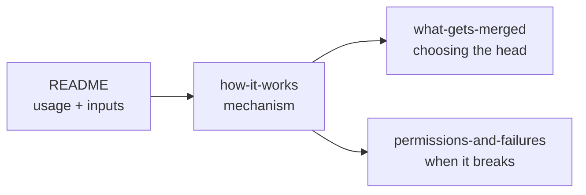

# Docs

Concepts behind the action, for people who maintain it or need to debug a merge that
didn't do what they expected. Start with the [main README](../README.md) for usage.

| Doc | Read it when |
|---|---|
| [How it works](how-it-works.md) | You want to know what happens between "workflow starts" and "merge commit appears", and why it uses the API instead of `git merge`. |
| [What gets merged](what-gets-merged.md) | A merge brought in more (or different) commits than you expected. Covers `GITHUB_SHA`, `head_to_merge` and `from_branch`. |
| [Permissions and failures](permissions-and-failures.md) | The step failed, or it succeeded but nothing downstream ran. |

