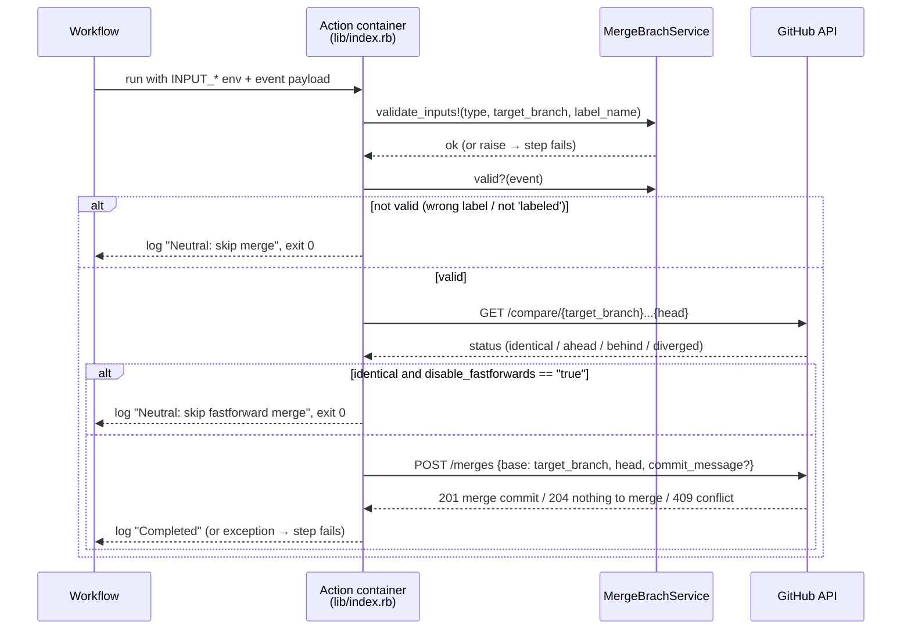

# How it works

> The action is a small Ruby script in a Docker container. It decides *whether* to merge from
> the inputs and the event, and then asks GitHub to do the merge on the server.

## The decision everything else hangs on: the API, not `git`

A typical "merge in CI" script checks out the repo, runs `git merge` and `git push`. This
action doesn't. It calls GitHub's
[merge endpoint](https://docs.github.com/en/rest/branches/branches#merge-a-branch), which is
the same as clicking merge on the server:

| | `git merge` + `git push` on the runner | This action (REST API) |
|---|---|---|
| Needs `actions/checkout` / full history | yes | no |
| Needs push credentials in the git remote | yes | only an API token |
| Conflict | you can script a resolution | fails with `409`, nothing to resolve |
| Your workspace after the step | contains the merge | unchanged |
| Merge strategy options (`-X ours`, squash…) | yes | no, always a merge commit |

The trade-off is simplicity over flexibility: one API call, no git state to manage, but no
way to resolve or customize the merge.

## Sequence

## Where each piece lives

| Concern | File |
|---|---|
| Entry point: reads env, resolves the head, calls the API | [`lib/index.rb`](../lib/index.rb) |
| Input validation and the `labeled` / `now` rule | [`lib/services/merge_branch_service.rb`](../lib/services/merge_branch_service.rb) |
| Inputs declared to GitHub | [`action.yml`](../action.yml) |
| Runtime image (Ruby + Octokit) | [`Dockerfile`](../Dockerfile) |
| Parser for `/merge to <branch>` comments (**not wired in**) | [`lib/adapters/comment_adapter.rb`](../lib/adapters/comment_adapter.rb) |
| Sample event payloads for tests | [`fixtures/`](../fixtures) |

## The two modes

- **`now`**: `valid?` is always `true`. The decision of *when* to merge is entirely in the
  workflow's `on:` section (e.g. `push` to `development`).
- **`labeled`**: `valid?` is true only if the event payload has `action: "labeled"` and
  `label.name` equal to `label_name`. Any other event (`opened`, `synchronize`, a different
  label) is a silent skip, not an error. That's why the workflow should listen to
  `pull_request: types: [labeled]`; listening to more types just produces skipped runs.

## About `disable_fastforwards`

The name suggests "never fast-forward". What the code actually checks is narrower: it skips only
when the compare status is `identical` (target and head point to the same commit). In every other
case it calls the merge endpoint. When the head is already contained in the target, GitHub
itself answers `204` and creates no commit, so an empty merge commit isn't expected in that
case either.
