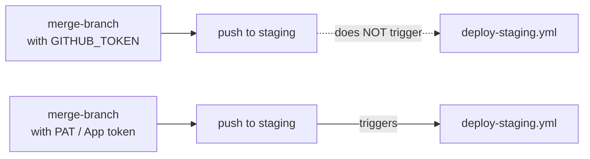

# Permissions and failures

> When the action fails, the step goes red and the log shows the error from GitHub. When it
> *skips*, the step stays green. Most "it didn't work" reports are one of the cases below.

## Token and permissions

The merge is an API write, so the token needs `contents: write`:

```yaml
permissions:
  contents: write
```

Without it (the default for `GITHUB_TOKEN` in many orgs is read-only) the API answers `403` and
the step fails.

### Merges with `GITHUB_TOKEN` don't trigger workflows

GitHub doesn't start new workflow runs for events caused by `GITHUB_TOKEN`
([GitHub docs](https://docs.github.com/en/actions/security-for-github-actions/security-guides/automatic-token-authentication#using-the-github_token-in-a-workflow)).
So if `staging` has a deploy workflow on `push`, merging into `staging` with this action
**won't deploy**.



Fix: pass a Personal Access Token or a GitHub App installation token as `github_token`.
That token is a stronger credential; scope it to this repo and to `contents: write`.

The same rule explains why the "Sync multiple branches" example can chain
`development → staging → uat` in **one job** with several steps, but can't rely on the merge to
`staging` triggering a second workflow that merges to `uat`.

## What each outcome looks like

| Log / status | Cause | What to do |
|---|---|---|
| green, `Neutral: skip merge ...` | `labeled` mode and the event isn't the configured label | Expected for other labels. Check `label_name` spelling (exact, case-sensitive). |
| green, `Neutral: skip fastforward merge ...` | `disable_fastforwards: "true"` and target == head | Nothing to do. |
| green, `Completed: Finish merge branch ...` | Merge done (or GitHub had nothing to merge) | — |
| red, `Error: Invalid type` | `type` is not `labeled` or `now` | Fix the input. `comment` is not supported. |
| red, `Error: Empty target branch` / `Empty target label name` | Missing required input | Fix the input. |
| red, `409 Merge conflict` | Head and target changed the same lines | Merge by hand, then re-run. |
| red, `404 Not Found` | Branch/SHA doesn't exist in this repo (typo, deleted branch, fork PR), or token can't see the repo | Check `target_branch` / `head_to_merge`. |
| red, `403` / protected branch message | Missing `contents: write`, or branch protection blocks direct pushes | Grant the permission, or allow the token's actor to bypass protection. |

## Branch protection

The merge endpoint writes directly to `target_branch`. If that branch requires pull request
reviews or status checks, GitHub rejects the write. Options: don't protect environment branches
that are meant to be updated automatically, or add the token's actor (a GitHub App works best)
to the bypass list.
