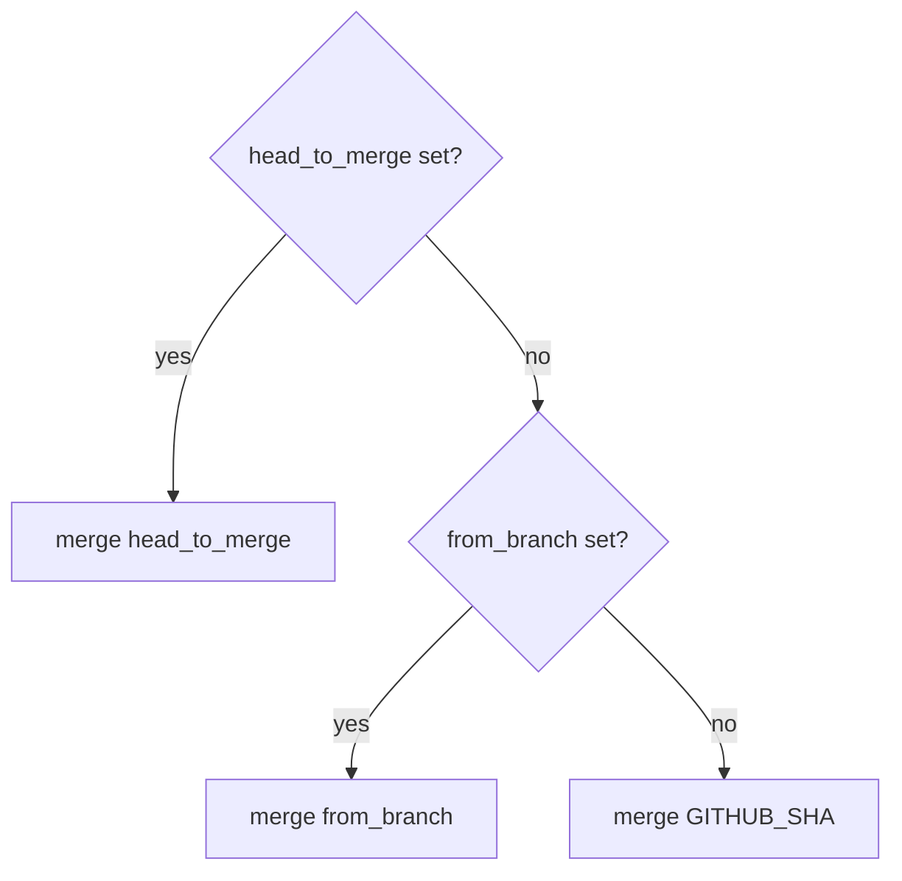

# What gets merged

> The action merges *one reference* into `target_branch`. Which reference that is depends on
> three inputs and on the event that triggered the workflow. Picking the wrong one is the most
> common reason a merge brings in unexpected commits.

## How the head is chosen

[`lib/index.rb`](../lib/index.rb) takes the first non-empty value:



`head_to_merge` and `from_branch` accept a branch name or a commit SHA.

## What `GITHUB_SHA` is, per event

`GITHUB_SHA` is set by GitHub, not by this action, and it means different things depending on
the trigger ([GitHub docs: events that trigger workflows](https://docs.github.com/en/actions/writing-workflows/choosing-when-your-workflow-runs/events-that-trigger-workflows)):

| Trigger | `GITHUB_SHA` is | What gets merged into `target_branch` |
|---|---|---|
| `push` to `release/1.2` | last commit pushed to `release/1.2` | the `release/1.2` branch, as expected |
| `pull_request` (`labeled`) | the PR's **test merge commit** (`refs/pull/N/merge`): the PR merged into its base branch | the PR's changes **plus** everything in its base branch that the target doesn't have |
| `pull_request_target` | last commit on the base branch | the base branch, **not** the PR |

## The `labeled` pitfall, with an example

A PR `feature/login` targets `main`. You add the label `merged in develop`. Without
`head_to_merge`, the action merges the test merge commit into `develop`. If `main` has commits
that `develop` doesn't, those come along too.

To merge only the PR branch:

```yaml
- uses: devmasx/merge-branch@master
  with:
    label_name: 'merged in develop'
    target_branch: 'develop'
    head_to_merge: ${{ github.head_ref }}   # the PR's source branch
    github_token: ${{ secrets.GITHUB_TOKEN }}
```

Caveat: `github.head_ref` is a branch name **in the PR author's repo**. For PRs from a fork that
branch doesn't exist in your repo and the merge fails with "not found". Use
`${{ github.event.pull_request.head.sha }}` only if you accept merging fork code into your
branch with a write token. Think about that before you do it.

## Quick reference

| You want | Set |
|---|---|
| "Push to `development` → also in `staging`" | `type: now`, `from_branch: development`, `target_branch: staging`, trigger on `push` to `development` |
| "Any `release/*` pushed → into `uat`" | `type: now`, `target_branch: uat` (head = `GITHUB_SHA` of the push) |
| "Label PR → its branch into `develop`" | `type: labeled`, `label_name`, `target_branch: develop`, `head_to_merge: ${{ github.head_ref }}` |
